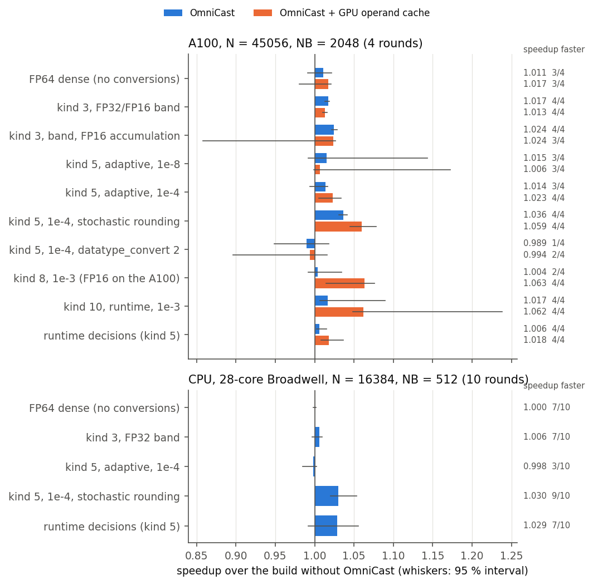

# HiCMA-X with and without OmniCast (2026-11-22)

The first round compared HiCMA-X with its own conversion kernels against the
first OmniCast ([`../README.md`](../README.md)). Rounds 2 and 3 were then
measured against the round before them, never again against HiCMA-X without
OmniCast. This page closes that gap: the final state against the code before
OmniCast, on the same machines, with identical builds.

| build | commit | conversions |
|---|---|---|
| without OmniCast | `4256ff9` | HiCMA-X 0.2's own CPU loops and CUDA kernels |
| with OmniCast | `f0ec341` | OmniCast v2 `0c59754` (round 3); the GPU operand cache on (default) or off (`--operand_cache 0`) |

Both trees have the same DPLASMA, PaRSEC, HCORE and STARS-H commits. They were
built side by side in git worktrees with the same options (Release, CUDA
architectures 70;80;90a, MKL, CUDA 12.6).



## Results

**Accuracy: identical.** On the A100 (N = 16384, NB = 2048, `--check 1`), all
10 configurations give the same residual ||LL^T − A||/||A|| to the last printed
digit without OmniCast, with OmniCast, and with the operand cache
([`data/a100_correctness_N16384.txt`](data/a100_correctness_N16384.txt)).
The two kind-3 band runs report "FAILED" in all three builds alike: they ran
with the default bound of 1e-8, which an FP16 band does not reach.

| configuration | residual (all three builds) |
|---|---|
| FP64 dense | 5.342370e-16 |
| kind 3, FP32/FP16 band | 1.237078e-07 |
| kind 3, band, FP16 accumulation | 1.344776e-05 |
| kind 5, adaptive, 1e-8 | 2.877597e-09 |
| kind 5, adaptive, 1e-4 | 1.221633e-07 |
| kind 5, 1e-4, stochastic rounding | 1.461554e-07 |
| kind 5, 1e-4, `--datatype_convert 2` | 1.221633e-07 |
| kind 8, 1e-3 (FP8 tiles use FP16 on the A100) | 4.895639e-06 |
| kind 10, runtime decisions, 1e-3 | 4.787225e-06 |
| runtime decisions (kind 5) | 1.537963e-08 |

**A100** (methane, A100-PCIE-40GB), N = 45056, NB = 2048, factorization time.
"faster" counts the rounds in which the build with OmniCast was faster.

| configuration | without OmniCast (s) | OmniCast (s) | speedup [95 % CI] | faster | OmniCast + operand cache (s) | speedup [95 % CI] | faster |
|---|---|---|---|---|---|---|---|
| FP64 dense (no conversions) | 2.679 | 2.651 | 1.011 [0.991, 1.022] | 3/4 | 2.648 | 1.017 [0.981, 1.021] | 3/4 |
| kind 3, FP32/FP16 band | 1.262 | 1.243 | 1.017 [1.013, 1.019] | 4/4 | 1.245 | 1.013 [1.010, 1.016] | 4/4 |
| kind 3, band, FP16 accumulation | 1.206 | 1.175 | 1.024 [1.021, 1.029] | 4/4 | 1.178 | 1.024 [0.858, 1.026] | 3/4 |
| kind 5, adaptive, 1e-8 | 2.238 | 2.224 | 1.015 [0.992, 1.143] | 3/4 | 2.217 | 1.006 [0.999, 1.172] | 3/4 |
| kind 5, adaptive, 1e-4 | 1.505 | 1.488 | 1.014 [0.994, 1.017] | 3/4 | 1.471 | 1.023 [1.006, 1.034] | 4/4 |
| kind 5, 1e-4, stochastic rounding | 1.578 | 1.520 | 1.036 [1.030, 1.041] | 4/4 | 1.490 | 1.059 [1.045, 1.078] | 4/4 |
| kind 5, 1e-4, `--datatype_convert 2` | 1.774 | 1.777 | 0.989 [0.949, 1.018] | 1/4 | 1.769 | 0.994 [0.896, 1.016] | 2/4 |
| kind 8, 1e-3 (FP16 on the A100) | 0.993 | 0.978 | 1.004 [0.992, 1.035] | 2/4 | 0.934 | 1.063 [1.015, 1.076] | 4/4 |
| kind 10, runtime decisions, 1e-3 | 1.125 | 1.110 | 1.017 [1.007, 1.089] | 4/4 | 1.063 | 1.062 [1.049, 1.238] | 4/4 |
| runtime decisions (kind 5) | 2.134 | 2.116 | 1.006 [1.003, 1.015] | 4/4 | 2.089 | 1.018 [1.008, 1.036] | 4/4 |

**CPU** (caffeine, Xeon E5-2660 v4, Broadwell, 28 cores, AVX2), N = 16384,
NB = 512. The operand cache is GPU only.

| configuration | without OmniCast (s) | OmniCast (s) | speedup [95 % CI] | faster |
|---|---|---|---|---|
| FP64 dense (no conversions) | 3.942 | 3.941 | 1.000 [0.998, 1.002] | 7/10 |
| kind 3, FP32 band | 4.836 | 4.827 | 1.006 [0.997, 1.009] | 7/10 |
| kind 5, adaptive, 1e-4 | 4.847 | 4.860 | 0.998 [0.985, 1.003] | 3/10 |
| kind 5, 1e-4, stochastic rounding | 5.066 | 4.903 | 1.030 [1.020, 1.054] | 9/10 |
| runtime decisions (kind 5) | 5.569 | 5.422 | 1.029 [0.992, 1.055] | 7/10 |

## Reading

- **A100, OmniCast alone: 1.01–1.04×.**
  - Stochastic rounding gains most (1.036×, faster in all 4 rounds), then
    the FP16 band kinds (1.017× and 1.024×, 4/4).
  - The others lie within ±2 %. That is also where FP64 dense lands
    (1.011×), and FP64 dense converts nothing, so ±2 % is the noise level here.
  - Conversions are 6–8 % of the GPU time on the A100 (Nsight Systems, first
    round) and overlap with GEMMs, so a faster conversion kernel can only move
    the total by a few percent. In the first
    round, at N = 32768, OmniCast gave 0–1.6 %.
- **A100, with the GPU operand cache: up to 1.06×.** Each GPU now converts a
  GEMM operand once per factorization instead of once per GEMM:
  - stochastic rounding: 1.059×;
  - kind 8 (FP8 tiles become FP16 on the A100): 1.063×;
  - kind 10: 1.062×;
  - all three faster in 4 of 4 rounds.

  The cache is built on OmniCast's conversion calls, so it exists only in the
  build with OmniCast.
- **`--datatype_convert 2`: no measurable change** (0.989× and 0.994×; both
  intervals contain 1, and OmniCast was faster in only 1 and 2 of 4 rounds).
- **CPU: stochastic rounding 1.03× (9/10 rounds), the rest unchanged.** In the
  first round, on methane's 36-core Skylake-SP (AVX-512), stochastic rounding
  was 18–19 % faster. The Broadwell is 2.9× slower per factorization (FP64
  dense 3.94 s against 1.37 s), so its GEMMs take a larger share and the
  conversions a smaller one. Runtime decisions show 1.029× but the interval
  contains 1.
- **The intervals of the A100 runs are coarse.** They come from 4 paired
  rounds; the "faster" column is the more robust reading there.

## Not measured

- **The H100 with FP8 tiles**, where conversions matter most: up to 19 % of
  the GPU time without the cache (round 3). hexane was in use by another
  user's job throughout.
  - Round 3 measured the final build against the round-2 build there, and
    the round-2 build already used OmniCast. FP8 factorizations at
    N = 45056 were 1.07–1.08× faster (`../round3/REPORT.md`).
  - OmniCast's FP8 operand conversions are 4.8–5.1× faster than HiCMA-X's
    kernels in isolation (second round, 8192² tiles).
  - An H100 run of `gpu.sh` against `4256ff9` remains to be done.
- **The V100 and the Radeon VII.** HiCMA-X had no HIP FP8 path before
  OmniCast, and the Radeon VII has no FP8.

## Method

- **Interleaved rounds.** Each round runs every configuration with the three
  builds back to back, so a slow phase of the machine hits all three.
  Ratios are paired by round.
- **Timing.** Each process factorizes 3 times (`--nruns 3`); the first run is
  dropped as warm-up and the other two are averaged.
- **Rounds.** 4 rounds on the A100, 10 on the CPU. The 95 % intervals are
  bootstrap intervals of the median of the paired ratios.
- **A100 cool-down.** The A100-PCIE in methane throttles thermally: it ran at
  82–83 °C against an 85 °C limit, and its counter showed hours of "SW Thermal
  Slowdown". Before each process the script waits until the GPU is at or
  below 65 °C, and it logs the throttle time of each run: 0 ms in all 120
  runs, at most 72 °C. The process is bound to the GPU's NUMA node
  (`numactl --cpunodebind=1 --membind=1`).
- **Exclusive nodes.** Both nodes were allocated with
  `salloc/srun --exclusive`, with nothing else of ours running on them. The
  CPU runs use `srun`; a plain `salloc -w node script` would run the script on
  the login node.
- **Discarded attempts.** Two earlier attempts were thrown away:
  - CPU runs meant for caffeine ran on methane next to the A100 runs;
  - an A100 run overlapped a cancelled one whose script kept going after
    `scancel`, and the overlapped processes failed.

  Their logs are not used anywhere.

## Reproducing

```bash
# the two trees, built the same way (worktree recipe: submodules need protocol.file.allow)
git worktree add --detach ../hicma-x-cmp-base4256 4256ff9
git worktree add --detach ../hicma-x-cmp-head f0ec341
# ... submodule init, then in each: cmake -G Ninja -S . -B build_cuda -DCMAKE_BUILD_TYPE=Release \
#     -DHICMA_PARSEC_HAVE_CUDA=ON -DCMAKE_CUDA_ARCHITECTURES="70;80;90a" (and build_cpu with CUDA OFF)
export HICMA_BASE=../hicma-x-cmp-base4256/build_cuda HICMA_HEAD=../hicma-x-cmp-head/build_cuda
salloc -p shared -w methane --exclusive --gres=gpu:nvidia:1 ./gpu_check.sh   # residuals, N=16384
ROUNDS=4 salloc -p shared -w methane --exclusive --gres=gpu:nvidia:1 ./gpu.sh > data/a100_N45056.txt
export HICMA_BASE=../hicma-x-cmp-base4256/build_cpu HICMA_HEAD=../hicma-x-cmp-head/build_cpu
ROUNDS=10 srun -p shared -w caffeine --exclusive ./cpu.sh > data/cpu_broadwell_N16384.txt
python3 make_figure.py                                                       # tables and figure
```

On an H100, set `CUDA_VISIBLE_DEVICES` to the H100 and adapt the `numactl`
node in `gpu.sh` (hexane: node 0).
