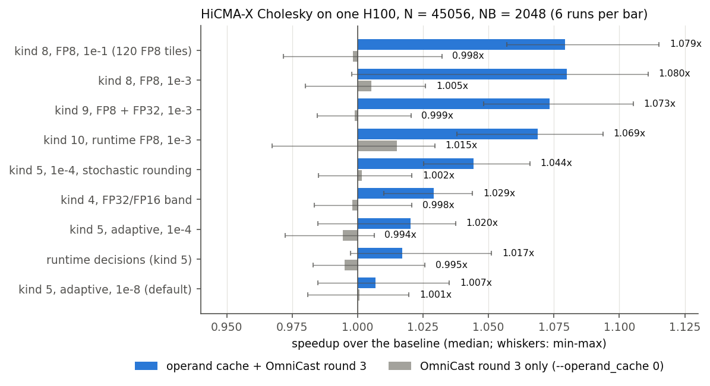
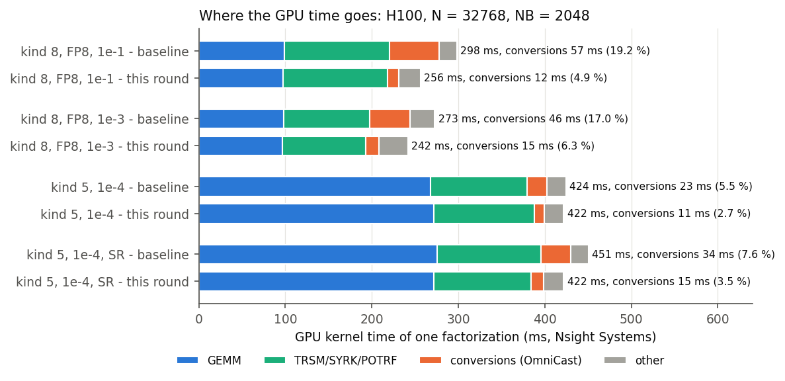
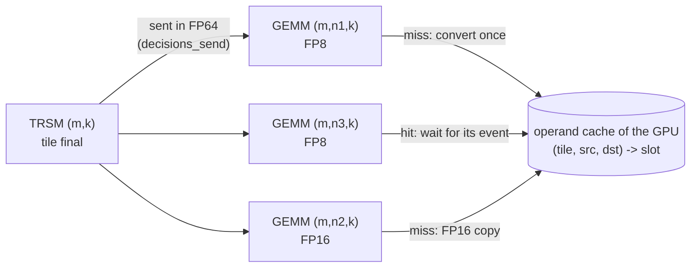
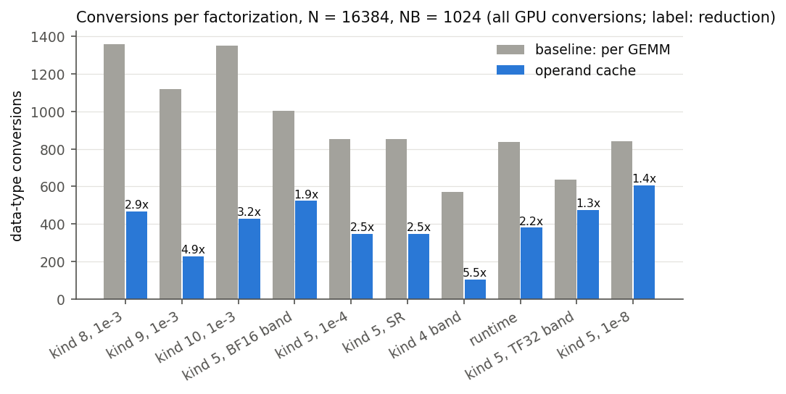
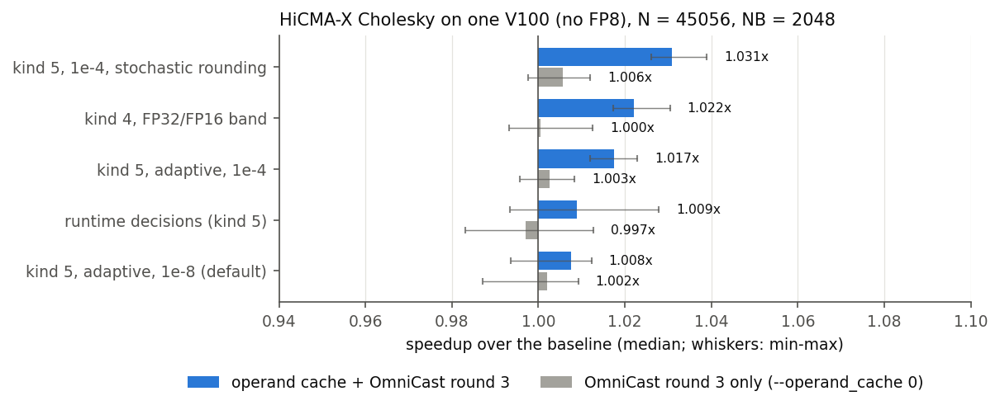
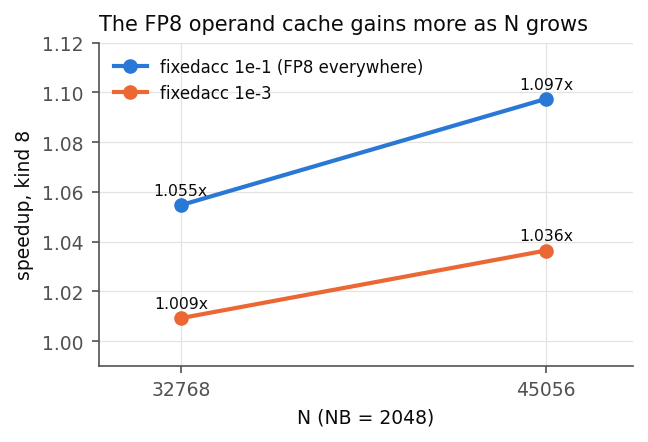

# Converting once, converting faster: the GPU operand cache and OmniCast round 3

HiCMA-X `qinglei/release-cleanup` after b72d652, OmniCast `v2` at 0c59754,
measured 2026-11-22 on an H100 (hexane), V100 (leconte), Radeon VII
(histamine), and Skylake-SP, Broadwell and Zen 2 hosts. Every number below
comes from a log in [`data/`](data/) or in OmniCast's
[`results/round3/`](../../../omnicast/results/round3/). `make_figures.py`
draws the figures from those logs.

## Summary

- **Problem.** In a mixed-precision Cholesky, a tile is sent in the highest
  precision any of its consumers needs. That is usually FP64, because the
  diagonal is FP64. So every FP32, FP16, BF16 and FP8 GEMM converted both of
  its operands again. Tile (m, k) was converted once per GEMM reading it, up
  to NT − 1 times: O(NT³) conversions for O(NT²) tiles. When most tiles are
  FP8, conversions took 19 % of the GPU kernel time on the H100.
- **HiCMA-X change.** Each GPU now keeps an operand cache. A tile is converted
  once per target precision, and every GEMM on that GPU reuses the copy.
  Results are bit-identical: 13 configurations × 4 cache settings give the
  same residuals, and CTest passes 55/55 on the H100 and on the V100.
  Conversions per factorization drop 1.3–5.5×.
- **OmniCast changes.**
  - FP8 encoding on sm_89+ uses the hardware convert (1.12–1.23× at 2048²).
  - The amax pass of dynamic scaling keeps 4 loads in flight.
  - On the host, FP8 encoding goes through F16C (1.0–2.3×), and in-place
    widening uses streaming stores (1.35–1.58× on Broadwell, 1.01–1.18× on Zen 2).
  - A fused single-kernel dynamic scaling is 1.03–1.33× faster on its own
    (up to 2.1× on the Radeon VII). It is opt-in because, next to other streams, it
    slows HiCMA-X down.
- **End to end** (H100, N = 45056, NB = 2048):
  - **1.07–1.08×** with FP8 (kinds 8, 9, 10).
  - 1.044× for kind 5 with stochastic rounding, 1.02–1.03× for the FP32/FP16
    kinds.
  - Unchanged (1.007×) at the default accuracy, where few tiles are converted.
- **The gain grows with N.** Per-GEMM conversions grow as NT³ and cached ones
  as NT². The FP8 cache alone gave 1.055× at N = 32768 and 1.097× at
  N = 45056.



## 1. Where the time went

The GEMM `C(m,n) -= A(m,k) B(n,k)^T` runs in the precision of C. A and B are
the panel tiles (m, k) and (n, k), received in their *send* precision
(`decisions_send`): the highest precision among all their consumers, which
include the SYRK of the diagonal tile. Before this change, each GEMM below
that precision converted both operands:

```
GPU GEMM (m, n, k), C in FP8:    A(m,k) FP64 -> amax -> FP8 (transposed, scaled)   every time
                                 B(n,k) FP64 -> amax -> FP8 (transposed, scaled)   every time
```

With NT = 16 and 120 FP8 tiles (`--fixedacc 1e-1`), that is 1120 conversions
of 120 distinct tiles. Nsight Systems on the H100 at N = 32768 (first bar of
each pair in the figure below) puts conversions at:

| configuration | conversions, share of GPU kernel time |
|---|---|
| kind 8, `--fixedacc 1e-1` (FP8 almost everywhere) | 19.2 % (amax 9.3 %, transposed convert 7.4 %) |
| kind 8, `--fixedacc 1e-3` | 17.0 % |
| kind 5, `--fixedacc 1e-4` (FP32/FP16 tiles) | 5.5 % |
| kind 5, `--fixedacc 1e-4`, stochastic rounding | 7.6 % |



## 2. The operand cache



- **What is cached.** Every operand conversion of the dense GPU GEMMs, in
  both the static path (`hicma_parsec_core_gemm_denseC_denseA_denseB_gpu`) and
  the runtime-decision path. That covers FP8 operands (transposed, padded,
  scaled per tile, scale stored after the entries), FP32 operands (from FP64
  or FP16) and FP16/BF16 operands (from FP64 or FP32). Conversions to FP64
  are not cached: they need a consumer in FP64, which forces an FP64 send, so
  they are rare.
- **Why results do not change.** A panel tile does not change after its TRSM.
  Its conversion depends only on the tile: stochastic rounding is seeded per
  tile (`hicma_parsec_sr_seed(m, k)`), and the runtime path's FP16 scale comes
  from the tile's norm. A cached copy is therefore the same bits a per-GEMM
  conversion would produce. The key is (matrix, factorization epoch, tile,
  source type, target type, stochastic rounding flag, scale).
- **Memory.** There are three caches per GPU, by element size: FP8 operands,
  2-byte and 4-byte tiles. Each takes slots from PaRSEC's device memory zone
  only when it first needs them, up to 2·NT slots, and at most 5 % of the
  zone per cache. A run without such conversions takes nothing. When a cache
  is full, or the zone has no room, the least recently used slot is converted
  again; this is never more conversions than before. Measured use at
  N = 16384, NB = 1024 is 67–218 MB.
- **Streams.** The streams of a GPU share its caches.
  - A GEMM on another stream than the conversion waits for the conversion's
    event.
  - A slot is overwritten only after the GEMMs that read it are done, on
    every stream (one event per stream per slot).
  - Slots are pinned between lookup and GEMM enqueue, and a mutex protects
    the table.
- **Epochs.** `hicma_parsec_potrf` bumps an epoch, so copies from an earlier
  factorization, or from the warmup, are never reused (`--nruns` included).
- **FP8 scales.** Each FP8 GEMM now points cuBLASLt's A/B scale attributes at
  the scales stored after the operand. This replaces two 16-byte
  device-to-device copies per FP8 GEMM.
- **Option.** `--operand_cache` takes -1 (default, automatic), 0 (off: convert
  per GEMM, as before), or N (up to N tiles per cache). With `--verbose 2`,
  each run prints
  `GPU_operand_cache: conversions= reuses= fallbacks= slots= MB=`.

The code is in `src/core/hicma_parsec_datatype_convert.c`
(`hicma_operand_cache_get` / `_put`, `hicma_operand_convert`),
`src/core/hicma_parsec_gpu.c` (creation, statistics) and
`src/core/hicma_parsec_core.c` (`hicma_operand`, used by both GEMM paths).

## 3. Correctness

- **Residuals, N = 16384, NB = 1024, H100**
  (`data/h100_correctness_N16384.txt`). I ran 13 configurations, each with
  the baseline library and with the cache on, off, and at 4 slots (heavy
  eviction):
  - kind 5 adaptive at 1e-8 and 1e-4, with stochastic rounding
  - BF16, BF16-C and TF32 bands
  - kind 3 bands with FP16 accumulation
  - kind 4 band
  - kinds 8, 9 and 10 at 1e-3
  - runtime decisions

  All 13 give the same ‖LLᵀ − A‖/‖A‖ to the printed digit under all four
  settings. The three configurations that exceed their `--check_tol` at this
  size do so identically on the baseline.
- **CTest.** 55/55 on the H100 and on the V100, and 30/30 in the CPU-only
  build (`data/tests.txt`). The HIP build compiles; it was not run (no gfx90a
  GPU here).
- **Stage 1** (FP8 cache only, before the generalization). Kinds 8, 9 and 10
  matched the baseline bit-for-bit as well, including with a 4-slot cache.

## 4. Performance

### 4.1 Conversions



The reduction is largest where many GEMMs share an operand that the cache
converts once: kind 4's static FP32/FP16 band (5.5×) and kind 9 (4.9×). Kind 5
at the default 1e-8 has few low-precision tiles. Of its 606 remaining
conversions, 101 are cache misses. The rest are TRSM-side and C-tile
conversions, which were already one per tile.

### 4.2 GPU kernel time

On the H100 at N = 32768 (the figure in section 1), OmniCast's share of the
GPU kernel time falls:

| configuration | before | after |
|---|---|---|
| kind 8, 1e-1 | 57 ms (19.2 %) | 12 ms (4.9 %) |
| kind 8, 1e-3 | 46 ms (17.0 %) | 15 ms (6.3 %) |
| kind 5, 1e-4 | 23 ms (5.5 %) | 11 ms (2.7 %) |
| kind 5, 1e-4, stochastic rounding | 34 ms (7.6 %) | 15 ms (3.5 %) |

The total GPU kernel time of one factorization drops by 42, 31, 2 and 29 ms.
The amax and transposed-convert launches of kind 8 at 1e-1 go from 1120 to
119, one per FP8 operand tile.

### 4.3 End to end

The figure in the summary has the H100 numbers: N = 45056, NB = 2048, three
interleaved rounds of `--nruns 3`, first run of each process dropped, so 6
runs per bar (`data/h100_end_to_end_N45056.txt`). The gray bars are this
round's OmniCast with the cache off. They show that the gain comes from the
cache: OmniCast's faster kernels alone are within noise end to end
(0.994–1.015×).

| configuration | baseline (s) | operand cache (s) | speedup |
|---|---|---|---|
| kind 8, 1e-1 | 0.414 | 0.383 | 1.079 |
| kind 8, 1e-3 | 0.455 | 0.421 | 1.080 |
| kind 9, 1e-3 | 0.441 | 0.411 | 1.073 |
| kind 10, 1e-3 | 0.525 | 0.491 | 1.069 |
| kind 5, 1e-4, stochastic rounding | 0.757 | 0.725 | 1.044 |
| kind 4, FP32/FP16 band | 0.630 | 0.612 | 1.029 |
| kind 5, 1e-4 | 0.733 | 0.718 | 1.020 |
| runtime decisions | 1.014 | 0.997 | 1.017 |
| kind 5, 1e-8 (default) | 1.077 | 1.070 | 1.007 |

On the V100 (no FP8 GEMMs; `data/v100_end_to_end_N45056.txt`, same method),
the cache helps the FP32/FP16 kinds by the same few percent:

| configuration | baseline (s) | operand cache (s) | speedup |
|---|---|---|---|
| kind 5, 1e-4, stochastic rounding | 1.957 | 1.898 | 1.031 |
| kind 4, FP32/FP16 band | 1.480 | 1.448 | 1.022 |
| kind 5, 1e-4 | 1.920 | 1.887 | 1.017 |
| runtime decisions | 2.660 | 2.636 | 1.009 |
| kind 5, 1e-8 (default) | 3.546 | 3.519 | 1.008 |



### 4.4 Larger problems gain more

Without the cache, each low-precision GEMM converts two operands:
2·Σₙ n·(NT−1−n) ≈ NT³/3 conversions. With it, there is at most one
conversion per tile and target precision, about NT²/2. The GEMMs also grow as
NT³, so the share of GPU *work* removed tends to a constant. The *time* saved
still grows with N in our runs. A likely reason is that at N = 32768 the
H100 is partly idle along the POTRF/TRSM panel chain, where extra conversion
work overlaps with idle time. A busier GPU turns removed work into removed
time. The first stage (FP8 cache only, same build for both sizes) measured:



## 5. OmniCast round 3

The details are in OmniCast's `docs/REPORT.md`, section 5. In short:

| change | where | measured |
|---|---|---|
| FP8 encode through `cvt.rn.satfinite.{e4m3,e5m2}x2.f32` on sm_89+ (saturating; NaN keeps the encoder's sign), also for FP64 sources (round to odd to FP32 first) | GPU | 1.12–1.23× for saturated encodes at 2048² on the H100, up to 1.13× at 8192²; 1.09× for HiCMA-X's transposed operand with a dynamic scale; bit-identical for every FP32 pattern |
| amax pass with 4 columns of loads in flight | GPU | 1.9× (1024²) and 1.19× (2048²) for the whole dynamic-scale convert on the Radeon VII |
| fused dynamic scaling: amax, a grid barrier, then the transposed convert in reverse tile order, from L2 (`OMNICAST_FUSED_DYNAMIC=1`) | GPU | 1.03–1.33× alone (H100), 1.1–2.1× (Radeon VII). Off by default: a cooperative kernel starts only when all its blocks fit, so beside GEMMs on other streams it waits and then holds the GPU (FP8-heavy HiCMA-X 4 % slower with it, 1 % with the operand cache) |
| host FP8 encode: F16C to FP16 rounded to odd (x·2⁻⁸ for E4M3 lines the FP16 pattern up with the FP8 one), then round to nearest even on 16-bit lanes; FP64 rounded to odd with MXCSR toward zero | host, AVX2 | 1.0–2.3× (Skylake-SP, Broadwell, Zen 2), never slower; bit-identical to the scalar encoder for every FP32 pattern (both formats, both saturation modes: 1.7·10¹⁰ values, on Zen 2 and on Broadwell), every FP16 and BF16 pattern, and FP64 values around the FP8 range with special values |
| host in place, growing types: streaming stores for segments ≥ 16 MB (not on Skylake-SP) | host | 1.01–1.18× (Zen 2; 1.13–1.18× except BF16), 1.35–1.58× (Broadwell) |
| persistent blocks for GPU in place | GPU | 0.94–1.02×: **dropped** |

HiCMA-X uses the hardware FP8 converts (its FP8 operands) and the amax change.
The host changes are for OmniCast's other users. HiCMA-X keeps FP8 on the GPU.

## 6. Reproducing

```bash
# correctness: residuals with the cache on, off and at 4 slots
testing_potrf_tlr --N 16384 --NB 1024 --kind_of_problem 2 --gpus 1 --check 1 --verbose 2 \
    --kind_of_cholesky 8 --adaptive_decision 1 --fixedacc 1e-3 [--operand_cache 0|4]
# end to end
testing_potrf_tlr --N 45056 --NB 2048 --kind_of_problem 2 --gpus 1 --check 0 --nruns 3 \
    --kind_of_cholesky 8 --adaptive_decision 1 --fixedacc 1e-3 [--operand_cache 0]
# GPU kernel time by class
nsys profile -t cuda -o run testing_potrf_tlr ...; nsys stats --report cuda_gpu_kern_sum --format csv ...
python3 omnicast/results/profiling/kern_share.py <dir with the csv files>
python3 docs/omnicast/round3/make_figures.py
```

On hexane the runs used `CUDA_VISIBLE_DEVICES=0` and
`numactl --cpunodebind=0 --membind=0`.
