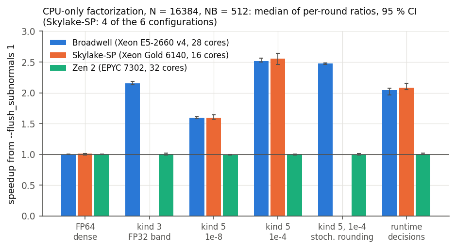

# Round 4: OmniCast merged, subnormals on the CPU, final tests

HiCMA-X `qinglei/release-cleanup` after aeef482 (OmniCast `main` at 4d0be85),
2026-11-23. Scripts and raw data are next to this file.

## Summary

- **OmniCast 2.0 is merged** (QingleiCao/OmniCast#1, merge commit 4d0be85,
  the same tree as v2 at 49388af). HiCMA-X tracks `main` (aeef482).
- **Tests of the merged state.** CTest `-L hicma` passes 30/30 on a Broadwell
  CPU (CPU-only build), 55/55 on an A100 and 46/46 on a Radeon VII (gfx906,
  HIP). The same suites pass again after the change below (section 4).
- **Optimization: subnormal numbers on Intel CPUs.** On the CPU, the
  mixed-precision Cholesky kinds were 1.2-1.4x *slower* than FP64. Their
  FP32 tiles hold many subnormal numbers, and on Intel CPUs every SIMD
  operation on one takes a microcode assist: 568 million assists in one
  factorization, against none in FP64. HiCMA-X now flushes subnormals on its
  CPU threads (`--flush_subnormals`, default on):
  - **1.6-2.6x faster** on a Broadwell and a Skylake-SP node for kinds 3, 5
    (with and without stochastic rounding) and runtime decisions. Mixed
    precision is now about 2x faster than FP64 there, as on the GPUs.
  - FP64 is unchanged. The residuals agree to 4-5 digits (to all printed digits
    for FP64 and runtime decisions).
  - An AMD Zen 2 CPU has no such penalty: unchanged (0.99-1.01x).
- **OmniCast fix found on the way.** OmniCast's host conversions changed
  under flush-to-zero (803 checks of `omnicast_cpu` and 288 of
  `omnicast_modes`). They now run in the default floating-point environment
  whatever the caller sets, in the calling thread and in the OpenMP threads.
  A new test runs 210 cases plus amax and the scalar functions both ways and
  compares bits. It fails 1333 checks without the fix. Cost: about 1 ns per
  call.
- **PaRSEC and DPLASMA fixes, on branches of the QingleiCao forks cut from
  upstream master** (no upstream pull request yet):
  - PaRSEC `gpu-host-copy-sends` and `arena-data-allocator` (the two
    multi-node fixes of 2026-11-22): CTest 256/256 on V100s.
  - PaRSEC `install-parsec-hwloc-header`: the installed `vpmap.h` includes a
    header that was not installed.
  - DPLASMA `adtt-null-register-hooks`: wrapping a collection whose
    `register_memory` is NULL crashed. Before the fix, POTRF on a GPU
    segfaulted with NULL hooks; after it, the factorization is correct.
- **H100 with and without OmniCast** (FP8 GEMMs; run when hexane was free,
  section 6): kinds 8 and 10 are 1.18x and 1.24x faster with OmniCast alone,
  and 1.24x and 1.33x with the operand cache. All residuals are identical.



## 1. OmniCast merged into main

QingleiCao/OmniCast#1 (v2 -> main) was merged with a merge commit, so 49388af
and every v2 commit that HiCMA-X's history points to stay reachable from
`main`. `main` had no commits of its own, so the merge commit's tree is the
tree of 49388af. HiCMA-X (aeef482) points the submodule at 4d0be85, and
`.gitmodules` tracks `main`. The `v2` branch is kept.

## 2. Tests of the merged state

All three trees were rebuilt from scratch on the merged state (HiCMA-X fe57f6b
+ OmniCast 4d0be85):

| platform | node | CTest `-L hicma` |
|---|---|---|
| CPU-only build | caffeine, 2x Xeon E5-2660 v4 (Broadwell, 28 cores) | 30/30 |
| CUDA | methane, A100-PCIE-40GB | 55/55 |
| HIP (ROCm 6.3.2) | histamine3, Radeon VII (gfx906) | 46/46 |

The H100 (CUDA, FP8) was not available: hexane was taken by another user's
job all night. CTest passed 55/55 there on 2026-11-22 with OmniCast
5e6212b, whose code is the same as 4d0be85's (49388af only adds the
license). The V100 node (leconte) was busy with other work.

## 3. Subnormal numbers on Intel CPUs

### 3.1 The symptom

From the CPU data of the final comparison (`docs/omnicast/final/`), on a
Broadwell node at N = 16384, NB = 512:

| configuration | FP32 tiles | time (s) |
|---|---|---|
| FP64 dense | 0 of 528 | 3.95 |
| kind 5, adaptive, 1e-4 | 496 of 528 | 4.86 |
| kind 3, FP32 band | 465 of 528 | 4.82 |
| runtime decisions | (FP32 GEMMs chosen at run time) | 5.42 |

With almost every tile in FP32, the factorization should take about half the
FP64 time. It took 23 % longer.

### 3.2 The cause

`perf record` on the same node:

| | FP64 dense | kind 5, 1e-4 |
|---|---|---|
| MKL GEMM kernels | 78 % `dgemm_kernel_0` | 85 % `sgemm_kernel_0` |
| OmniCast conversions | - | 1.0 % (`d2s_any` 0.75 %, `s2d_any` 0.26 %) |
| `fp_assist.any` (whole run) | 0 | 568 million |
| instructions per cycle | 2.70 | 1.34 |

The conversions are not the problem: an operand cache on the host like the
GPU one (round 3) would save at most 1 %. The FP32 GEMM kernel itself runs
slowly. Its time per flop is 1.35x that of the FP64 kernel, where it should
be about 0.5x. The cause is the assists. The test matrix is a squared
exponential covariance, so entries decay fast with distance. Many entries of
the off-diagonal tiles are below FP32's smallest normal number (1.2e-38) and
become subnormal in FP32, while in FP64 they are normal. On Intel cores a
SIMD multiply or FMA with a subnormal input or result takes a microcode
assist of about a hundred cycles.

Setting flush-to-zero (FTZ) and denormals-are-zero (DAZ) in a preloaded
library, without rebuilding, confirmed it. Kind 5 went from 4.8 to 1.92 s
and FP64 was unchanged.

### 3.3 The change

- **HiCMA-X.** New option `--flush_subnormals`, default 1
  (`hicma_parsec_internal.c`). Before `parsec_init`, HiCMA-X sets FTZ and DAZ
  in the main thread (MXCSR bits 15 and 6; FPCR.FZ on AArch64). The worker
  threads PaRSEC creates inherit them, including the main thread, which also
  runs tasks. `hicma_parsec_cleanup_parsec` restores the main thread's
  setting after `parsec_fini`. `--flush_subnormals 0` keeps IEEE subnormals.
  The GPUs are not affected.
- **Why flushing is safe here.** The precision decisions bound each tile's
  error relative to the matrix norm. A subnormal FP32 entry is below 1.2e-38,
  which is 30 orders of magnitude under FP32's unit roundoff relative to any
  tile those decisions keep. It is also below the precision that FP32
  subnormals still carry. For the same reason, the classic Intel compilers
  turn flush-to-zero on by default when optimizing.
- **OmniCast.** OmniCast promises the same bits on every backend. Under FTZ
  and DAZ, its host conversions changed:
  - `vcvtpd2ps` flushed subnormal FP32 results;
  - the FP32 additions in the small-format encoders read subnormal inputs as
    zero;
  - with another rounding mode, the AVX2 converts rounded differently.

  Every host entry point now runs under `FpEnvGuard`, which installs the
  default MXCSR (round to nearest, no FTZ/DAZ, exceptions masked) and
  restores the caller's value on return, keeping the status flags. Each
  OpenMP thread body takes its own guard, since every thread has its own
  register. The AArch64 version clears FPCR's FZ, FZ16, RMode, DN, AHP and
  trap-enable bits. It compiles for AArch64 (LLVM 17) but was not run: no ARM
  node here.

### 3.4 Validation

Residuals `||LL^T - A||_F / ||A||_F` and forward error `||L - L0||_F / ||L||_F`
(N = 16384, one checked factorization each):

| CPU | configuration | residual, flush 0 | residual, flush 1 | forward error, 0 / 1 |
|---|---|---|---|---|
| Broadwell | FP64 dense | 2.823523e-16 | 2.823523e-16 | 0 / 0 |
| Broadwell | kind 5, 1e-4 | 1.000728e-07 | 1.000715e-07 | 5.525700e-06 / 5.525648e-06 |
| Broadwell | kind 5, 1e-4, SR | 1.016499e-07 | 1.016487e-07 | 5.595964e-06 / 5.595960e-06 |
| Broadwell | kind 5, 1e-8 | 9.786492e-10 | 9.786633e-10 | 4.662329e-08 / 4.662385e-08 |
| Broadwell | runtime decisions | 2.672243e-09 | 2.672243e-09 | 1.332925e-07 / 1.332925e-07 |
| Broadwell | kind 3, FP32 band | 7.656630e-08 | 7.656632e-08 | 4.062188e-06 / 4.062186e-06 |
| Skylake-SP | kind 5, 1e-4 | 1.066791e-07 | 1.066770e-07 | 5.870230e-06 / 5.870175e-06 |
| Skylake-SP | kind 5, 1e-8 | 1.034451e-09 | 1.034462e-09 | 4.945553e-08 / 4.945608e-08 |
| Zen 2 | kind 5, 1e-4 | 9.172389e-08 | 9.172426e-08 | 5.019642e-06 / 5.019659e-06 |
| Zen 2 | kind 5, 1e-8 | 8.929961e-10 | 8.930581e-10 | 4.278252e-08 / 4.278557e-08 |

Kind 3's static FP32 band does not promise 1e-8, the default `--check_tol`,
so its check reports FAILED with and without flushing (7.66e-08). CTest checks
it at 1e-6. All the other checks pass. Full lists are in `data/cpu_*.txt`
(lines `check ...`).

OmniCast: `omnicast_cpu` gained a test that computes 210 cases twice:
14 pairs and option sets (plain, saturated, scaled, stochastic, dynamic
power-of-two, integer nearest) × 5 layouts (1-D, 1-D on 4 threads, 2-D with
ld > m, transposed, in place) × every CPU code path. It also covers amax of a
subnormal array and 4096 values through the scalar functions. The first pass
runs in the default environment, the second with FTZ, DAZ and round toward
zero set in the caller and in the OpenMP threads, and the bits are compared.
It passes; without the guard it fails 1333 checks.

### 3.5 Performance

Interleaved rounds (flush 1, flush 0, next configuration). Each process runs
three factorizations, the first is dropped and the other two are averaged.
Speedups are the median of per-round ratios, with a bootstrap 95 % interval.
N = 16384, NB = 512, all cores of the node (16 on methane, through Slurm).
Tables from `make_figure.py`:

| CPU | configuration | flush 0 (s) | flush 1 (s) | speedup [95 % CI] | faster in |
|---|---|---|---|---|---|
| Broadwell | FP64 dense | 3.947 | 3.954 | 1.00 [1.00, 1.00] | 1/4 |
| Broadwell | kind 3, FP32 band | 4.821 | 2.255 | 2.15 [2.13, 2.19] | 4/4 |
| Broadwell | kind 5, adaptive, 1e-8 | 4.665 | 2.919 | 1.60 [1.59, 1.61] | 4/4 |
| Broadwell | kind 5, adaptive, 1e-4 | 4.863 | 1.926 | 2.51 [2.50, 2.57] | 4/4 |
| Broadwell | kind 5, 1e-4, stoch. rounding | 4.924 | 1.990 | 2.47 [2.46, 2.48] | 4/4 |
| Broadwell | runtime decisions | 5.423 | 2.648 | 2.04 [1.96, 2.07] | 4/4 |
| Skylake-SP | FP64 dense | 3.945 | 3.907 | 1.01 [0.99, 1.01] | 2/3 |
| Skylake-SP | kind 5, adaptive, 1e-8 | 4.771 | 3.018 | 1.59 [1.57, 1.64] | 3/3 |
| Skylake-SP | kind 5, adaptive, 1e-4 | 5.158 | 1.950 | 2.56 [2.46, 2.65] | 3/3 |
| Skylake-SP | runtime decisions | 5.602 | 2.728 | 2.08 [2.05, 2.15] | 3/3 |
| Zen 2 | FP64 dense | 3.336 | 3.327 | 1.00 [1.00, 1.00] | 3/4 |
| Zen 2 | kind 3, FP32 band | 1.814 | 1.800 | 1.01 [0.99, 1.02] | 2/4 |
| Zen 2 | kind 5, adaptive, 1e-8 | 2.313 | 2.337 | 0.99 [0.99, 1.00] | 0/4 |
| Zen 2 | kind 5, adaptive, 1e-4 | 1.577 | 1.570 | 1.00 [0.99, 1.01] | 3/4 |
| Zen 2 | kind 5, 1e-4, stoch. rounding | 1.618 | 1.622 | 1.00 [0.99, 1.01] | 1/4 |
| Zen 2 | runtime decisions | 2.157 | 2.142 | 1.01 [0.99, 1.02] | 3/4 |

Reading:

- **Against FP64.** On both Intel CPUs, kind 5 at 1e-4 now takes 49 % of the
  FP64 time (1.93 against 3.95 s on Broadwell), against 123 % before. That
  matches Zen 2, where mixed precision was already 2.1x faster than FP64.
- **Methane.** It is a shared login node (Skylake-SP), so its rounds are
  noisier; flush 0's later rounds were slower than its first. The ratios are
  paired by round, and all were above 2.4 for kind 5 at 1e-4.
- **Zen 2.** Kind 5 at 1e-8 was 1 % slower with flushing in all four rounds.
  That is inside the spread of the other Zen 2 cases, and there is no known
  mechanism; it is reported as measured.
- **Tile low-rank (TLR).** On Broadwell, N = 54000, NB = 1350, maxrank 300,
  one factorization per process, three rounds (`data/tlr_caffeine.txt`):

  | configuration | flush 0 (s) | flush 1 (s) | speedup [95 % CI] | faster in |
  |---|---|---|---|---|
  | TLR, FP64 (kind 2) | 3.460 | 3.463 | 1.00 [1.00, 1.00] | 1/3 |
  | TLR, adaptive precision (kind 1) | 3.348 | 3.276 | 1.02 [1.02, 1.02] | 3/3 |

  Kind 1 has 40 dense FP64 tiles, 260 low-rank FP64 and 520 low-rank FP32.
  Its FP32 work is in low-rank products of rank about 25, which do few flops
  per entry, so it gains little.

### 3.6 GPUs are not affected

`subnormal_gemm.cpp` (next to this file) times a GEMM C -= A B^T in FP32 and
in FP16 with FP32 accumulation, with entries O(1) or subnormal (FP32 about
1e-39, FP16 about 3e-6), 20 calls after a warm-up:

| GPU | n | SGEMM normal / subnormal (ms) | FP16 GEMM normal / subnormal (ms) |
|---|---|---|---|
| A100 (cuBLAS, CUDA 12.6) | 2048 | 1.571 / 1.571 | 0.233 / 0.233 |
| A100 | 4096 | 12.68 / 11.07 | 0.601 / 0.553 |
| Radeon VII (rocBLAS, ROCm 6.3.2) | 2048 | 1.998 / 1.995 | 1.487 / 1.456 |
| Radeon VII | 4096 | 12.46 / 11.79 | 12.44 / 11.97 |

Subnormal inputs cost nothing on either GPU; if anything they are a little
faster. So `--flush_subnormals` only touches the CPU threads, and OmniCast's
GPU kernels keep IEEE subnormals (`--ftz=false`, `-fno-fast-math`).

### 3.7 Guard cost

Guard cost in OmniCast (methane, one core, best of 5): a 16-element
FP64 -> FP32 call stays at about 20 ns, and the scalar `omc_fp32_to_fp16` goes
from 2.5 to 3.3 ns. For the tile sizes HiCMA-X converts (2-32 MB), that is
nothing.

## 4. Tests after the change

With `--flush_subnormals` (default on) and the OmniCast guard, all three trees
rebuilt:

| platform | CTest `-L hicma` |
|---|---|
| CPU-only build (caffeine, Broadwell) | 30/30 |
| A100 (methane) | 55/55 |
| Radeon VII (histamine3, HIP) | 46/46 |

These suites include OmniCast's own tests: the new floating-point environment
test in `omnicast_cpu`, and on the GPUs `omnicast_gpu` and
`omnicast_modes_gpu`.

## 5. PaRSEC and DPLASMA fixes on fork branches

Each fix sits on its own branch of the QingleiCao fork, cut from the upstream
master of the day and signed off. No pull request was opened upstream.

| repository | branch | base | what | tested |
|---|---|---|---|---|
| QingleiCao/parsec | `gpu-host-copy-sends` (26db25908) | ICLDisco master 09c721868 | send the host copy of a GPU-read flow when MPI cannot read GPU memory (from 72c90800e) | CTest 256/256 on 2 V100s; the 16 GPU tests also with `mpi_gpu_aware` 0 and 1 |
| QingleiCao/parsec | `arena-data-allocator` (f2fc371ac) | same | the application can choose the allocator of arena memory (from 7ff8d542a; conflict with the fork's arena cache size resolved to upstream's value) | same |
| QingleiCao/parsec | `install-parsec-hwloc-header` (0ed5d8854) | same | install `parsec_hwloc.h`, which the installed `vpmap.h` includes; DPLASMA master did not compile against an installed PaRSEC master | DPLASMA built against the installed PaRSEC without extra include paths |
| QingleiCao/dplasma | `adtt-null-register-hooks` (e0d5af53) | ICLDisco master 5b2137e6 | `dplasma_wrap_data_collection` forwarded `register_memory` / `unregister_memory` without checking for NULL, which PaRSEC means "nothing to register" | POTRF (V100) with the matrix's hooks set to NULL: segfault before, factorization and solution correct after; GEMM passes |

The full PaRSEC CTest was 255/256 at first on both branches. The one failure,
`dsl/dtd/simple_gemm:gpu`, was the test not finding MKL on leconte, and it
passes with MKL on the library path.

## 6. H100 with and without OmniCast

The H100 part of the final comparison (`docs/omnicast/final/`) is the
same two builds as the A100 run (4256ff9 without OmniCast, f0ec341 with it)
and the same scripts, with `GPU=0 NUMA=0`.
- **When:** Slurm job 66786 (`--exclusive`) waited until hexane was free and
  ran 2026-11-23 from 12:35 to 13:27 UTC.
- **Runs:** five interleaved rounds of 10 configurations × 3 builds, plus one
  checked run of each.
- **Temperature:** at most 70 °C, and no thermal slowdown in any of the 150
  runs.

| configuration | OmniCast | OmniCast + operand cache | faster |
|---|---|---|---|
| kind 8, 1e-3 (FP8 GEMMs) | 1.181 [1.152, 1.203] | 1.242 [1.231, 1.277] | 5/5, 5/5 |
| kind 10, runtime decisions, 1e-3 (FP8 GEMMs) | 1.241 [1.182, 1.254] | 1.329 [1.301, 1.335] | 5/5, 5/5 |
| kind 5, 1e-4, stochastic rounding | 1.052 [1.045, 1.054] | 1.096 [1.092, 1.102] | 5/5, 5/5 |
| runtime decisions, 1e-8 (kind 10) | 1.054 [1.048, 1.066] | 1.072 [1.059, 1.083] | 5/5, 5/5 |
| kind 3 and kind 5, FP32/FP16 tiles | 1.012-1.038 | 1.023-1.037 | 5/5 |
| FP64 dense (no conversions) | 1.005 [0.989, 1.017] | 0.997 [0.985, 1.016] | 3/5, 2/5 |

Speedups are over the build without OmniCast: the median of the per-round
ratios, with the 95 % interval.

- **Residuals:** identical in all 10 configurations across the three builds,
  as on the A100.
- **Why FP8 gains most:** before OmniCast, each FP8 operand went through
  HiCMA-X's own transposed conversion (one byte per thread, strided stores,
  plus a memset, an amax pass and a scale).

Full tables and figure: `docs/omnicast/final/README.md`.

## 7. Next steps

- **Kind 10 on the CPU (runtime decisions).** With flushing on (Broadwell,
  N = 16384), 10.0 % of the time goes into FP64 -> FP32 conversions: 9342
  conversions for 528 tiles, because every GEMM converts both FP64 operands
  again. Another 5.1 % is in `..._runtime_decision_cpu` itself, which reads
  each updated C tile again to recompute its precision. An operand cache on
  the host like the GPU one (one FP32 copy per panel tile, freed when the
  panel's last GEMM has read it) would remove most of the 10 %. Kind 5 spends
  2.3 % converting, so it would gain little.
- **OmniCast release.** The guard is QingleiCao/OmniCast#2 (1bd1803, which the
  submodule points at). It is a behavior fix and would fit an OmniCast 2.0.1.
  Once it is merged, point the submodule at `main` again.
- **AArch64 run.** The guard and `--flush_subnormals` compile for AArch64 but
  were not run there.

## Reproducing

```bash
# A/B on one CPU node (CPU-only build of HiCMA-X in build_cpu)
srun -p shared -w <node> -N1 -n1 --exclusive docs/omnicast/round4/ab.sh > cpu_<node>.txt
srun -p shared -w <node> -N1 -n1 --exclusive docs/omnicast/round4/tlr.sh > tlr_<node>.txt
python3 docs/omnicast/round4/make_figure.py      # tables + figures/flush_subnormals_cpu.png
# subnormal assists (Intel)
perf stat -e fp_assist.any,cycles,instructions -- build_cpu/tests/testing_potrf_tlr --N 16384 --NB 512 \
    --kind_of_problem 2 --adaptive_decision 1 --fixedacc 1e-4 --flush_subnormals 0
```
